# dsh-android-app

<p align="center">
  <strong>Your own DeepSeek Harness, on Android.</strong>
</p>

<p align="center">
  <a href="./README.md">中文</a> · English
</p>

<p align="center">
  
  
  
  
</p>

`dsh-android-app` is a native Android client for your own DeepSeek Harness installation. It connects through [dsh-workspace](https://github.com/Hakunm/dsh-workspace), keeping your phone and DSH WebUI on the same workspaces, sessions, models, and files.

Continue conversations, follow task progress, decide approvals and interactive questions, switch permissions and models, or browse, search, and edit authorized server files from your phone. The app defaults to Chinese, supports switching to English, and automatically follows the system Light/Dark appearance by default.

## Screenshots

### 1. Home, Slide-Over Navigation & Dual-Mode Appearance

<table>
  <tr>
    <td align="center" width="33.3%">
      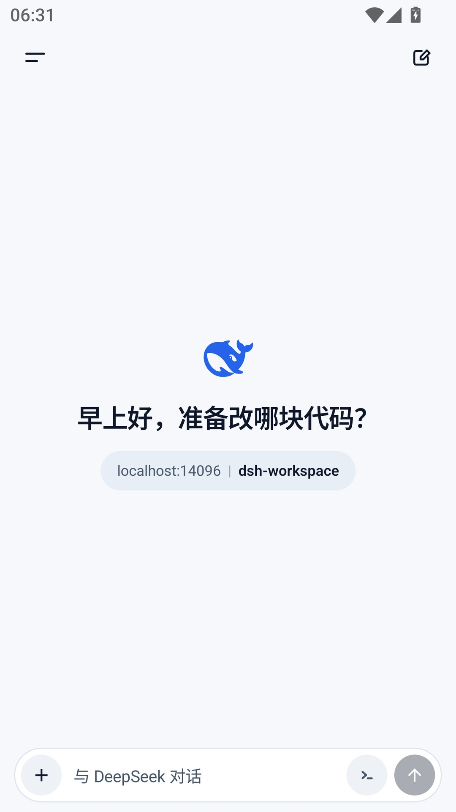<br>
      <sub><b>Chat Home (Light)</b><br>Workspace switcher pill &amp; floating composer</sub>
    </td>
    <td align="center" width="33.3%">
      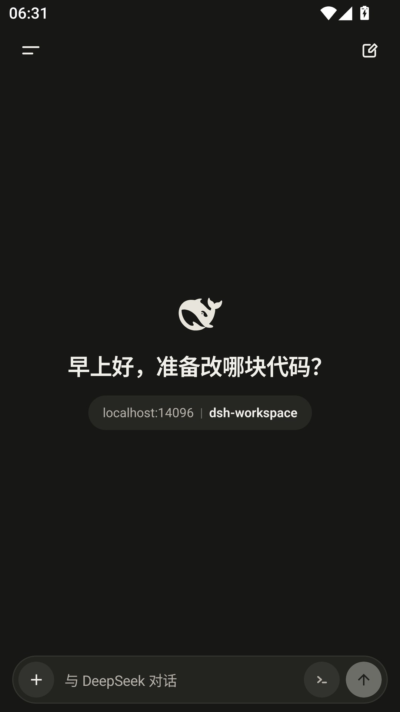<br>
      <sub><b>Chat Home (Dark)</b><br>Automatic system-following dark appearance</sub>
    </td>
    <td align="center" width="33.3%">
      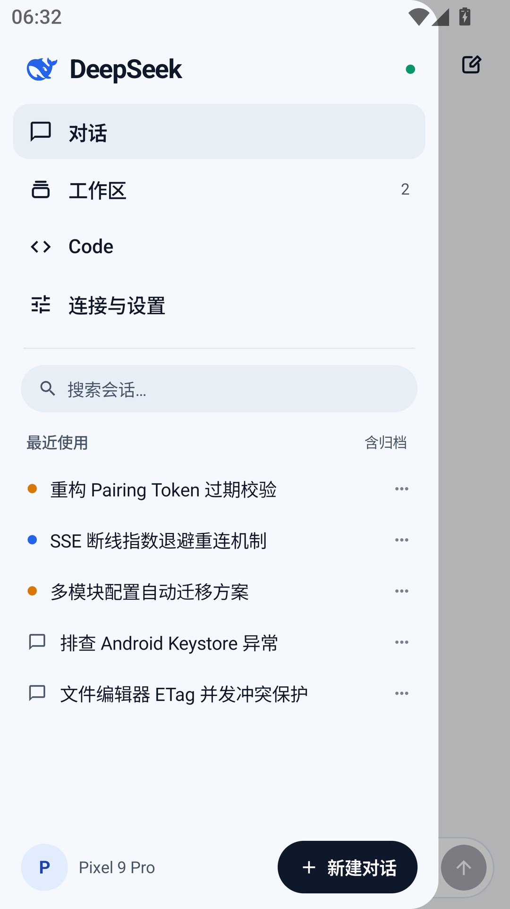<br>
      <sub><b>Navigation Drawer &amp; Recents</b><br>Section links, full-text search &amp; pinned sessions</sub>
    </td>
  </tr>
</table>

### 2. Composer Attachments, Slash Commands & Model Routing

<table>
  <tr>
    <td align="center" width="33.3%">
      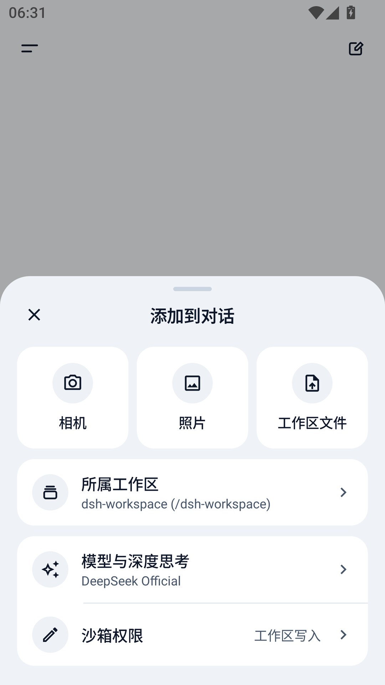<br>
      <sub><b>Add to Chat (+)</b><br>Camera, photos, files &amp; sandbox access mode</sub>
    </td>
    <td align="center" width="33.3%">
      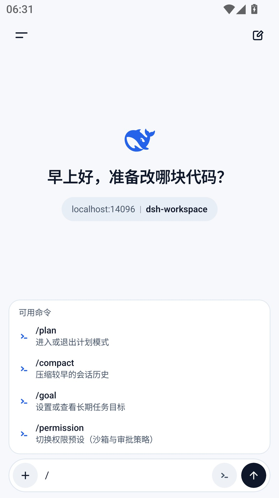<br>
      <sub><b>Host Slash Commands (/)</b><br>Autocomplete and run server session commands</sub>
    </td>
    <td align="center" width="33.3%">
      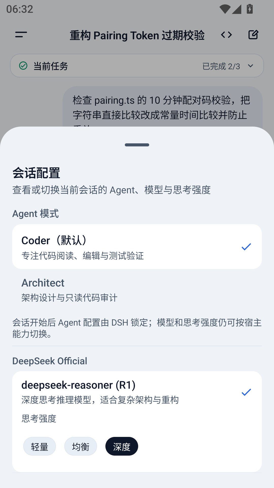<br>
      <sub><b>Session Configuration</b><br>Switch Agent preset, model route &amp; reasoning effort</sub>
    </td>
  </tr>
</table>

### 3. Coding Stream, Command Approvals & Interactive Questions

<table>
  <tr>
    <td align="center" width="33.3%">
      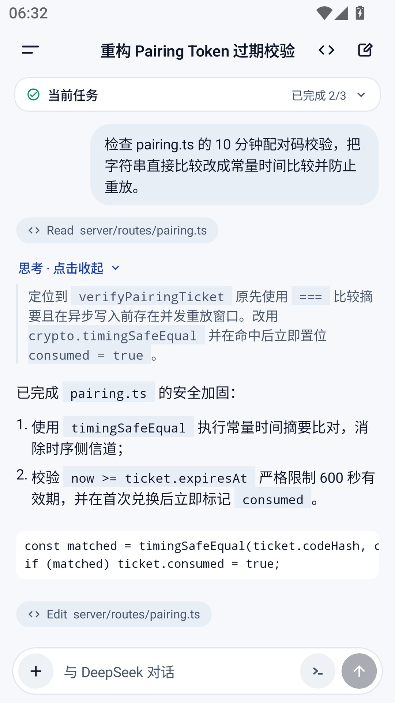<br>
      <sub><b>Coding Chat &amp; Reasoning</b><br>TODO progress, tool pills, collapsible thinking &amp; code</sub>
    </td>
    <td align="center" width="33.3%">
      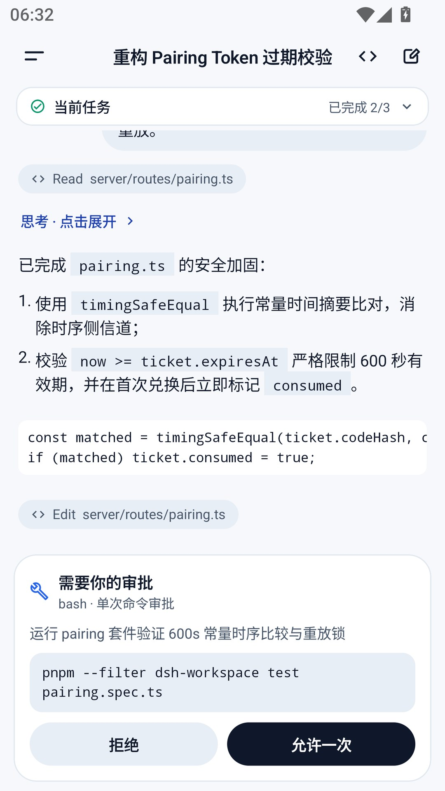<br>
      <sub><b>Single-Time Approval</b><br>Inspect redacted command preview &amp; Allow once / Reject</sub>
    </td>
    <td align="center" width="33.3%">
      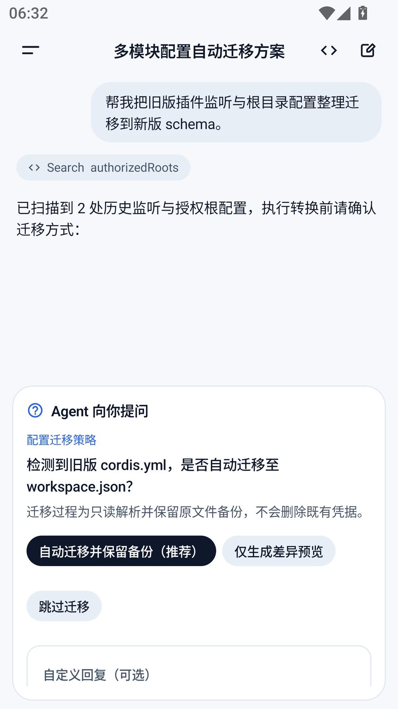<br>
      <sub><b>Interactive Agent Question</b><br>Answer single/multi-select prompts inline</sub>
    </td>
  </tr>
</table>

### 4. Workspaces & Code File Editor

<table>
  <tr>
    <td align="center" width="33.3%">
      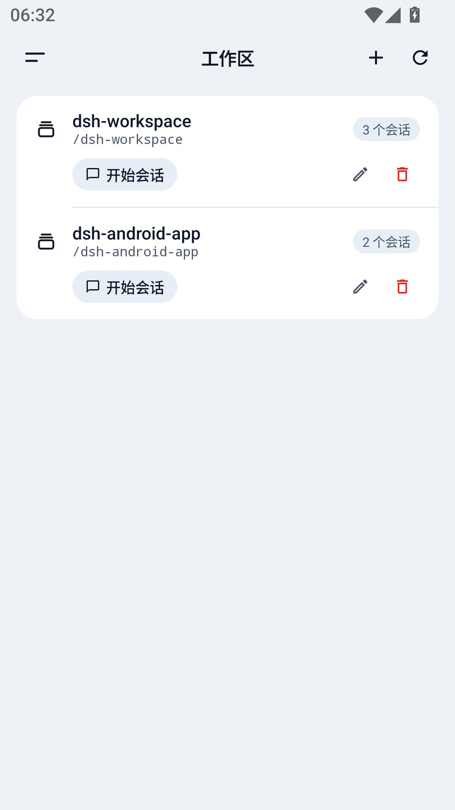<br>
      <sub><b>DSH Workspaces</b><br>Browse, rename, remove or start a chat in any workspace</sub>
    </td>
    <td align="center" width="33.3%">
      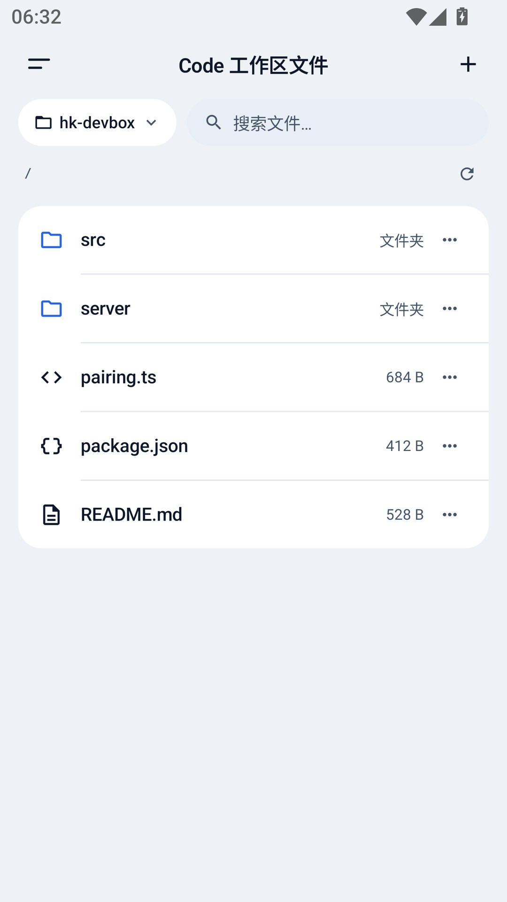<br>
      <sub><b>Code File Browser</b><br>Root selector, recursive search, upload &amp; trash</sub>
    </td>
    <td align="center" width="33.3%">
      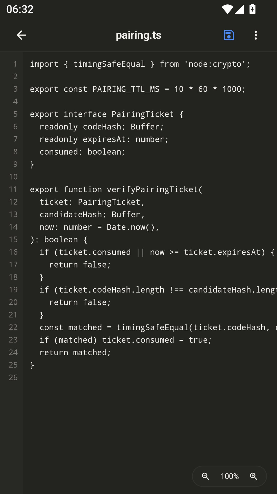<br>
      <sub><b>Line-Numbered Editor</b><br>Synchronized gutter, Markdown preview, ETag &amp; zoom</sub>
    </td>
  </tr>
</table>

### 5. Device Pairing, Settings & Model Providers

<table>
  <tr>
    <td align="center" width="33.3%">
      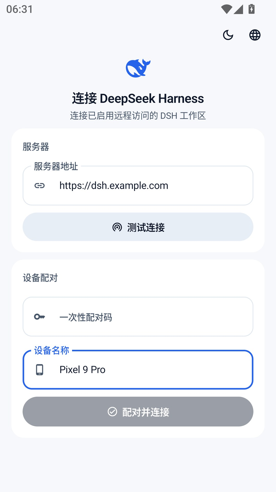<br>
      <sub><b>One-Time Device Pairing</b><br>Health check, 10-minute pairing code &amp; Keystore storage</sub>
    </td>
    <td align="center" width="33.3%">
      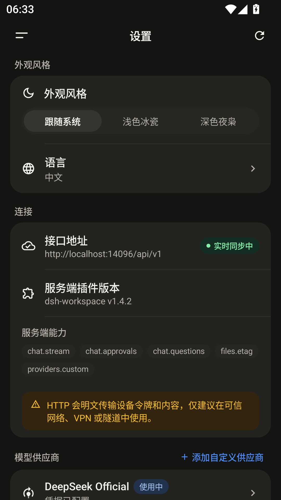<br>
      <sub><b>Settings &amp; Connection</b><br>Appearance modes, language toggle &amp; server capabilities</sub>
    </td>
    <td align="center" width="33.3%">
      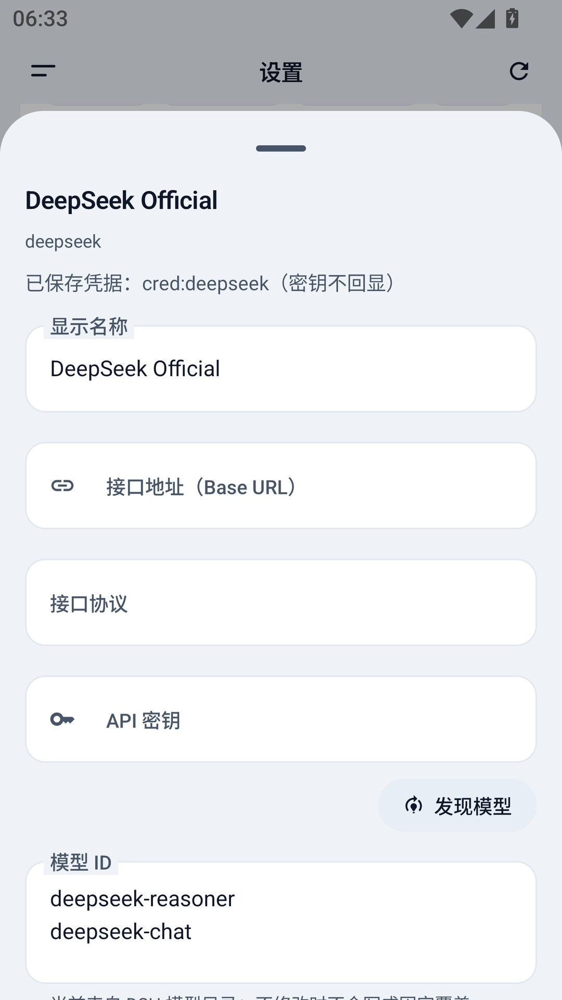<br>
      <sub><b>Model Provider Editor</b><br>Write-only API keys, model discovery &amp; custom routes</sub>
    </td>
  </tr>
</table>

## Download

Download the latest release from [GitHub Releases](https://github.com/Hakunm/dsh-android-app/releases/latest):

```text
DeepSeek-Harness-v1.2.0.apk
```

Requirements:

- Android 8.0 / API 26 or newer
- A running DeepSeek Harness WebUI installation
- `dsh-workspace` v1.2.0 or a compatible release installed in DSH WebUI
- At least one authorized root and remote access enabled in the plugin
- Network reachability from the phone to the configured IP/domain and port

The production APK uses a dedicated release certificate, not the Android debug key. Future releases must use the same certificate for in-place upgrades.

## Connect to DSH

### On the server

1. Open **Workspace settings** for `dsh-workspace` in DSH WebUI.
2. Add at least one authorized root.
3. Enter the bind IP and port under **Remote access**, then save the listener settings.
4. Select **Enable and create pairing** to receive a ten-minute one-time code.

### On the phone

1. Enter the server address, such as `http://192.168.1.20:3090` or `https://dsh.example.com`.
2. Enter the pairing code and a device name.
3. Select **Pair and connect**.

The device token is stored using Android Keystore-backed encrypted storage. Transient network errors keep the saved token so you can reconnect without re-pairing. Disconnecting clears the local token, and revoking the device in DSH WebUI invalidates it immediately.

## Chat and task control

- View authorized DSH sessions and live run state.
- Stream assistant text and reasoning, then reconcile with server history on completion.
- Render Markdown headings, lists, quotes, code blocks, and tables.
- Send text, camera photos, and gallery image attachments; manage queued messages (edit, remove, or steer); or cancel a running task.
- Follow DSH TODO progress and the currently active item.
- Type `/` or tap the command button to browse and run host-provided slash commands.
- Open the `+` sheet to switch between server-provided permission modes (Read only, Workspace write, and Full access with confirmation).
- Review redacted approval details to Allow once or Reject, and answer interactive agent questions inline.
- Select a model and reasoning effort. Empty sessions can also select an Agent before the first message.

## Workspaces and sessions

From the Home screen, you can pick any registered DSH WebUI workspace and send a prompt to start a new session immediately, or open the New Session sheet to browse an authorized root and register an existing directory as a new DSH workspace.

The Workspaces view supports listing, creating, renaming, and removing workspace registrations. Removing a registration does not delete its directory, files, or session logs.

The slide-over navigation drawer provides quick access to Chats, Workspaces, Code files, and Settings, along with full-text session search and an archived-sessions toggle. Each session menu provides:

- **Pin / Unpin** to keep priority conversations at the top.
- **Rename** to change its DSH WebUI title.
- **Fork** to create a child session with the existing history, working directory, and model configuration.
- **Archive / Unarchive** to hide it from the default list and restore it later from the archived view.

The app only shows workspaces and sessions whose working directory is inside a root granted to the device. Server absolute paths are not exposed through the public API.

## File management

- Lazy browsing of authorized roots and directories, with recursive file search.
- Create folders/files, upload, download, and replace.
- Rename, move, and send entries to plugin trash.
- View and restore trash items without overwriting path conflicts.
- Edit UTF-8 text with synchronized line numbers.
- Switch between Markdown source and rendered preview.
- Zoom source and preview from `75%-250%` using controls or pinch gestures.
- Detect external changes with ETags and refuse silent overwrites.
- Treat binary files as metadata/download/replace only.

The app cannot add server roots or permanently purge plugin trash. Those high-privilege operations remain available only in the server's local DSH WebUI.

## Model providers

With `settings.read`, the app can view effective provider configuration, default Base URLs, models, and whether credentials are present. API key values are never returned by the server.

With `settings.write`, it can also:

- edit provider names, Base URLs, protocols, models, and reasoning settings;
- write or clear provider credentials;
- discover models from compatible services;
- create and remove fully custom DSH providers and model routes.

## Permissions

The server controls which features are available:

| Scope | App access |
| --- | --- |
| `chat.read` | Workspaces, sessions, search, messages, queue, TODOs, commands, approvals, and questions |
| `chat.write` | Manage workspaces/sessions, send text &amp; images, edit queue, configure, run commands, decide approvals, and answer questions |
| `files.read` | Browse, search, preview, download, and view trash |
| `files.write` | Create, edit, upload, move, and rename |
| `files.delete` | Move files or directories to plugin trash |
| `settings.read` | Provider and model configuration |
| `settings.write` | Edit, create, or remove providers and write credentials |

Every device also needs explicit root grants. A server administrator can change scopes, update root grants, or revoke the device at any time.

## HTTP warning

Both `http://` and `https://` are supported. Plain HTTP sends device tokens, chat, and file content in clear text. It is suitable only for a trusted LAN, VPN, or temporary test.

Use HTTPS through Caddy/Nginx, Tailscale/WireGuard, another VPN, or a trusted tunnel on public or untrusted networks. Do not share pairing codes, device tokens, or APK signing material.

## Privacy

- No advertising or third-party analytics SDKs.
- Device tokens use Android Keystore-backed encrypted storage.
- Provider secrets are written to the DSH credential store and never read back into the app.
- Chat and file data is sent only to the DSH address configured by the user.

## Troubleshooting

**No workspace is available when creating a session**

Switch to **New workspace** and select a directory from an authorized root, or register a workspace in DSH WebUI first.

**Some actions are disabled**

The device lacks the required scope, or the server plugin is on an older version. Update device scopes under **Devices** or upgrade `dsh-workspace`.

**The app cannot connect**

Confirm remote access is enabled, the firewall/security group allows the port, and the address is reachable from the phone. Do not enter the server's own `127.0.0.1` address.

**A session appears stuck**

Check the conversation for an approval panel or an interactive question card. Operations requiring permission or user input do not advance automatically in the background.

**A save reports a conflict**

Another process changed the server file. Reload, merge the desired content, and save again.

## Build from source

Use JDK 17 and Android SDK 37:

```sh
./gradlew testDebugUnitTest lintDebug assembleRelease
```

Release builds require a private signing configuration:

```properties
storeFile=/absolute/path/to/release-signing.p12
storePassword=...
keyAlias=...
keyPassword=...
```

Pass it with `-PdshSigningProperties=/path/to/signing.properties`. Never commit signing files or passwords.

## Project

- Version: `v1.2.0`
- Package: `io.github.hakunm.deepseekharness`
- Author: [Github@Hakunm](https://github.com/Hakunm)
- License: [GNU Affero General Public License v3.0](./LICENSE) (third-party notices in [NOTICE](./NOTICE))
- Server plugin: [dsh-workspace](https://github.com/Hakunm/dsh-workspace)
