# dsh-android-app

<p align="center">
  <strong>把你自己的 DeepSeek Harness 带到 Android 手机上。</strong>
</p>

<p align="center">
  中文 · <a href="./README.en.md">English</a>
</p>

<p align="center">
  
  
  
  
</p>

`dsh-android-app` 是 DeepSeek Harness 的原生 Android 客户端。它通过 [dsh-workspace](https://github.com/Hakunm/dsh-workspace) 连接你自己的 DSH WebUI，让手机与网页端使用同一套工作区、会话、模型和文件。

你可以在手机上继续聊天、查看任务进度、处理审批与提问、切换权限与模型，也可以直接浏览、搜索和编辑服务器允许访问的文件。App 默认中文，可在设置中切换 English，外观默认跟随系统自动切换浅色/深色模式。

## 界面预览

### 1. 主界面、侧滑导航与浅/深双模式

<table>
  <tr>
    <td align="center" width="33.3%">
      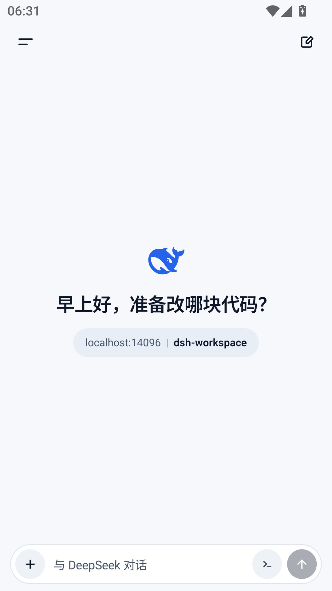<br>
      <sub><b>对话主页（浅色）</b><br>工作区快速切换与胶囊输入栏</sub>
    </td>
    <td align="center" width="33.3%">
      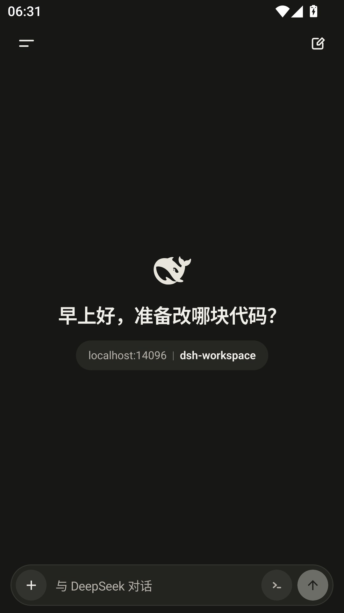<br>
      <sub><b>对话主页（深色）</b><br>跟随系统自动切换深色外观</sub>
    </td>
    <td align="center" width="33.3%">
      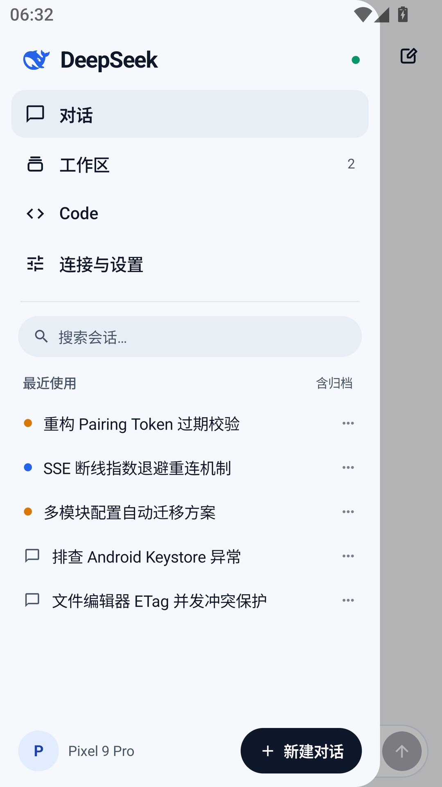<br>
      <sub><b>侧滑导航与最近会话</b><br>全局模块切换、全文搜索与会话置顶</sub>
    </td>
  </tr>
</table>

### 2. 对话输入扩展、斜杠命令与模型配置

<table>
  <tr>
    <td align="center" width="33.3%">
      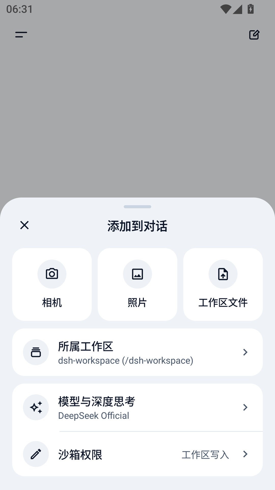<br>
      <sub><b>添加到对话（+）</b><br>相机、相册、文件与沙箱权限快捷控制</sub>
    </td>
    <td align="center" width="33.3%">
      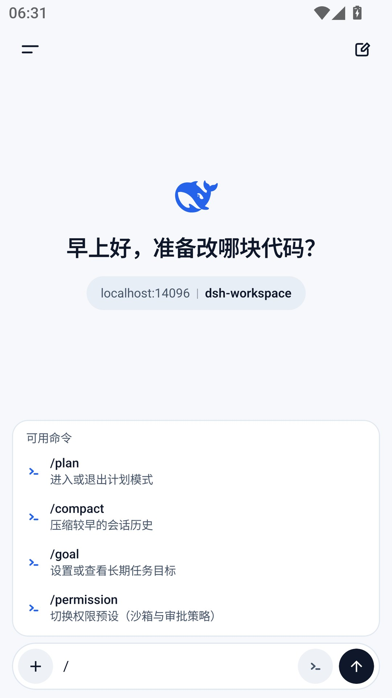<br>
      <sub><b>宿主斜杠命令（/）</b><br>即时浏览并执行服务端会话命令</sub>
    </td>
    <td align="center" width="33.3%">
      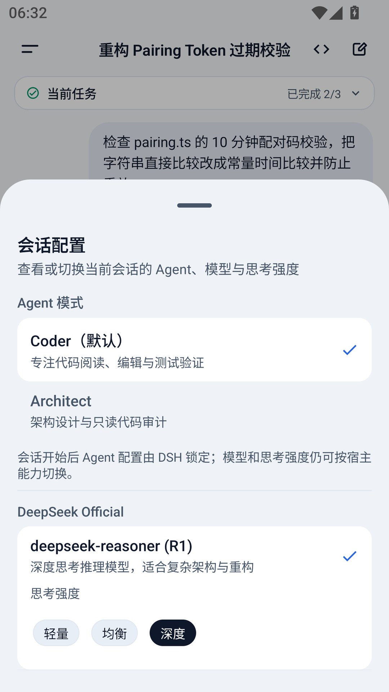<br>
      <sub><b>会话配置面板</b><br>切换 Agent 模式、模型路由与思考强度</sub>
    </td>
  </tr>
</table>

### 3. 编码会话流、越界审批与交互提问

<table>
  <tr>
    <td align="center" width="33.3%">
      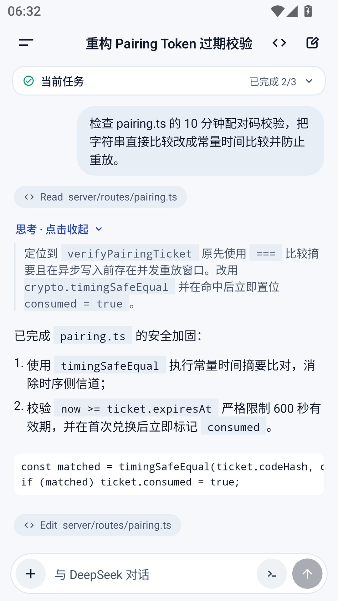<br>
      <sub><b>编码会话与思考链</b><br>任务进度、工具摘要、可折叠思考与代码排版</sub>
    </td>
    <td align="center" width="33.3%">
      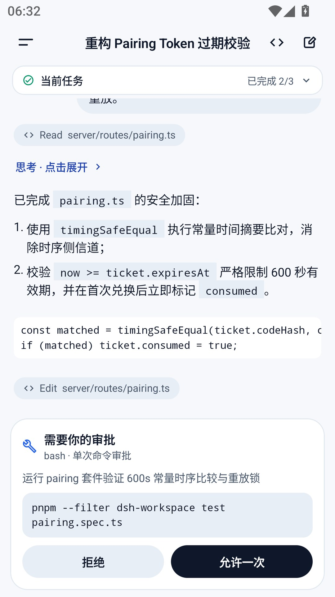<br>
      <sub><b>单次命令审批</b><br>查看脱敏命令预览并决定允许一次或拒绝</sub>
    </td>
    <td align="center" width="33.3%">
      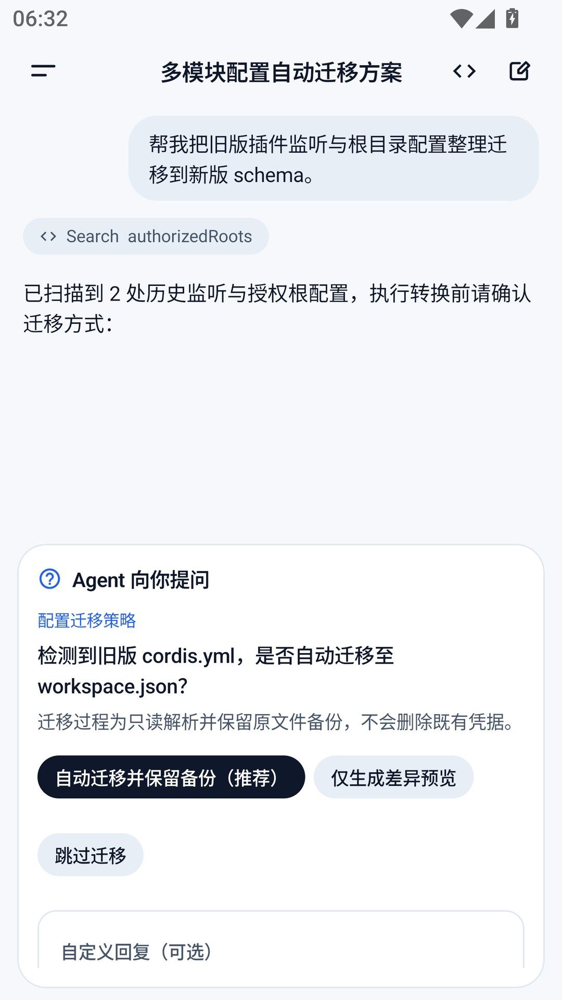<br>
      <sub><b>Agent 交互式提问</b><br>任务中途单选/多选澄清与自定义回复</sub>
    </td>
  </tr>
</table>

### 4. 工作区管理与 Code 文件编辑

<table>
  <tr>
    <td align="center" width="33.3%">
      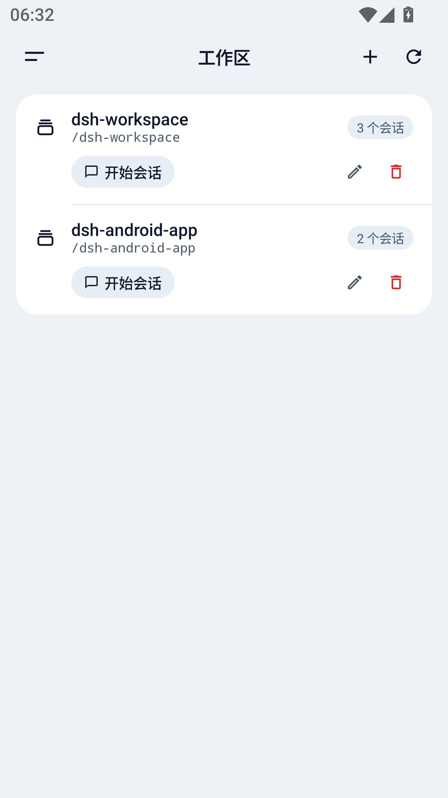<br>
      <sub><b>DSH 工作区管理</b><br>查看、重命名、移除登记或直接发起会话</sub>
    </td>
    <td align="center" width="33.3%">
      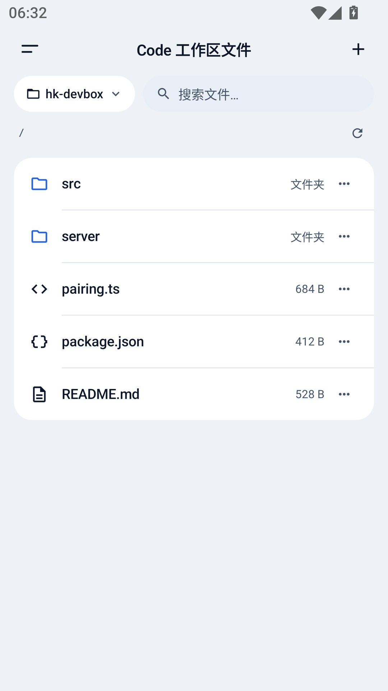<br>
      <sub><b>Code 文件浏览与搜索</b><br>授权根目录切换、递归搜索与回收站</sub>
    </td>
    <td align="center" width="33.3%">
      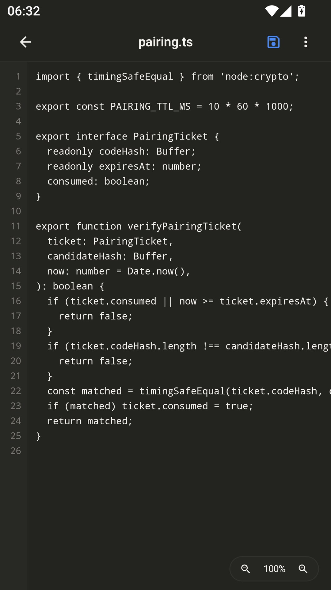<br>
      <sub><b>行号代码编辑器</b><br>同步行号、Markdown 预览、ETag 与缩放</sub>
    </td>
  </tr>
</table>

### 5. 设备配对、系统设置与模型供应商

<table>
  <tr>
    <td align="center" width="33.3%">
      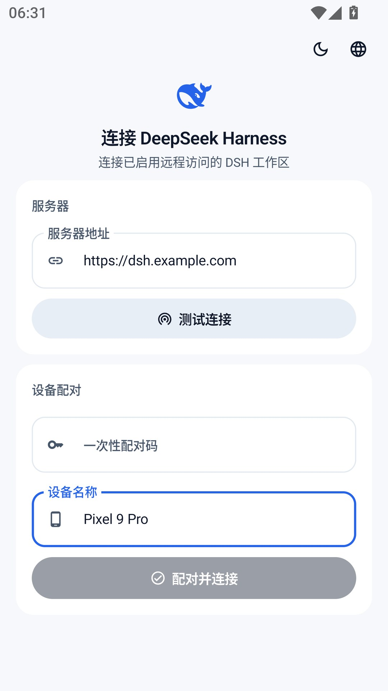<br>
      <sub><b>设备一次性配对</b><br>连接测试、十分钟配对码兑换与安全存储</sub>
    </td>
    <td align="center" width="33.3%">
      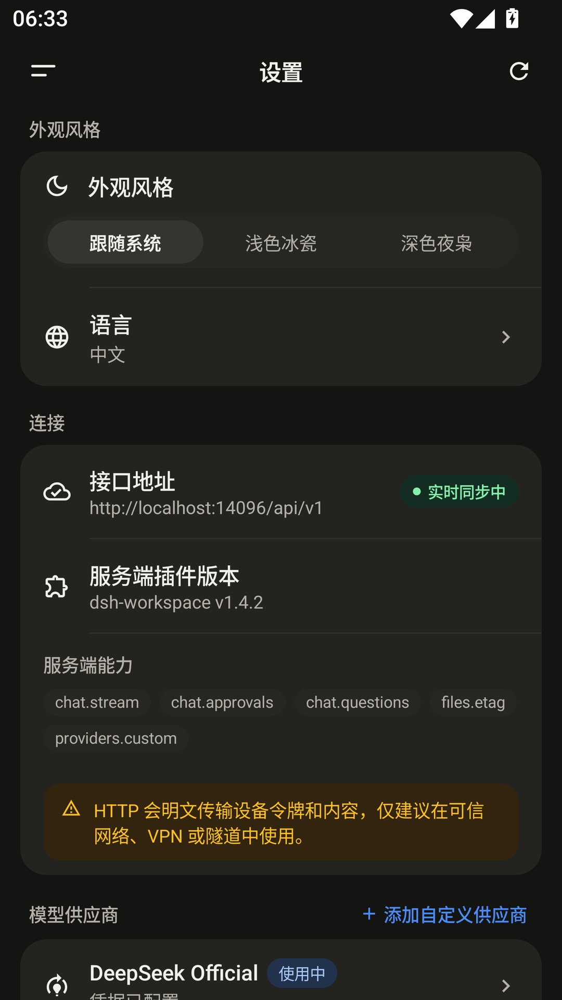<br>
      <sub><b>设置与连接状态</b><br>三档外观、中英切换与服务端能力查看</sub>
    </td>
    <td align="center" width="33.3%">
      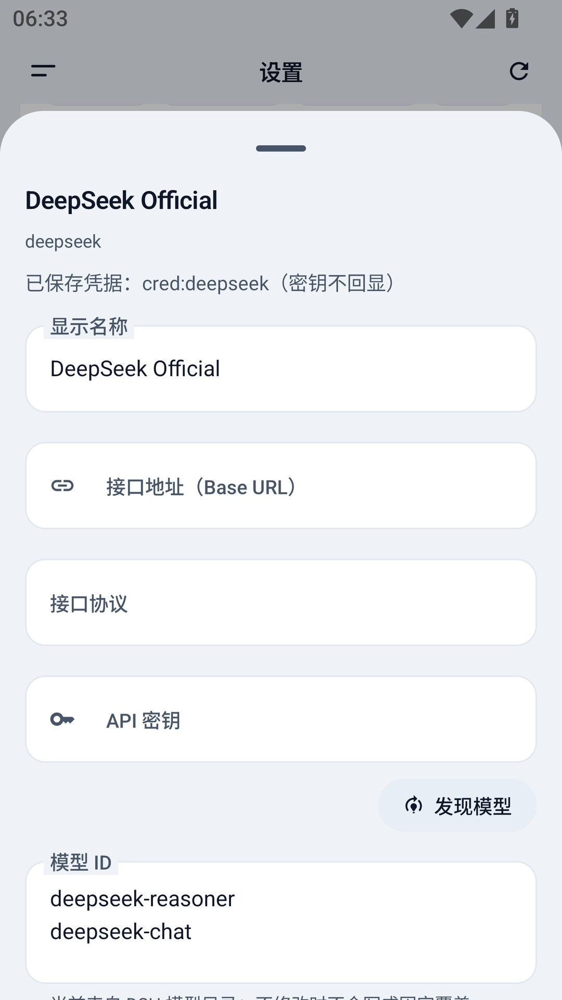<br>
      <sub><b>模型供应商配置</b><br>API 密钥只写存储、模型发现与自定义路由</sub>
    </td>
  </tr>
</table>

## 下载与安装

从 [GitHub Releases](https://github.com/Hakunm/dsh-android-app/releases/latest) 下载：

```text
DeepSeek-Harness-v1.2.0.apk
```

安装要求：

- Android 8.0（API 26）或更高版本
- 已运行的 DeepSeek Harness WebUI
- DSH WebUI 已安装 `dsh-workspace` v1.2.0 或兼容版本
- 插件中至少添加了一个授权根，并已启用远程访问
- 手机可以访问插件配置的 IP、域名和端口

正式 APK 使用项目独立的发布证书签名，不使用 Android 测试签名。后续版本需要使用同一证书，才能直接覆盖更新。

## 连接你的 DSH

### 服务器端

1. 在 DSH WebUI 打开 `dsh-workspace` 的“工作区设置”。
2. 添加至少一个授权根目录。
3. 在“远程访问”页填写绑定 IP 和端口，并保存监听设置。
4. 点击“启用并创建配对”，取得十分钟内有效的一次性配对码。

### 手机端

1. 输入服务器地址，例如 `http://192.168.1.20:3090` 或 `https://dsh.example.com`。
2. 输入配对码和设备名称。
3. 点击“配对并连接”。

设备令牌由 Android Keystore 支持的加密存储保存。App 重启后会恢复连接，临时网络异常时保留令牌以便重试；在 App 中断开会清除本机令牌，在 WebUI 撤销设备会让令牌立即失效。

## 聊天不只是收发消息

- 查看设备有权访问的 DSH 会话和实时运行状态。
- 以流式增量显示助手正文和思考，结束后与服务器历史校准。
- 正确排版 Markdown 标题、列表、引用、代码块和表格。
- 发送文字、相机拍照与相册图片附件，管理排队消息（编辑、删除或插队引导），以及取消当前任务。
- 查看 DSH TODO 模块、完成进度和正在处理的事项。
- 输入 `/` 或点击命令按钮浏览并执行服务器提供的 host 斜杠命令。
- 在 `+` 面板按服务器权限目录切换“只读”“工作区写入”“完整访问”。完整访问会再次提示风险。
- 查看待审批工具调用的脱敏信息，选择“允许一次”或“拒绝”，并在任务发起交互提问时直接作答。
- 切换模型和思考强度。空白会话还可以在首条消息前选择 Agent。

## 工作区与会话

在主页可直接选择已登记的 DSH WebUI 工作区并发送消息自动开始新会话；也可以在新建会话面板中从设备获准访问的根目录挑选现有目录，将它登记为新的 DSH 工作区。

工作区页支持：

- 查看设备可访问的 DSH 工作区。
- 创建、重命名和移除工作区登记。

移除登记不会删除服务器目录、文件或会话日志。

左侧导航抽屉集中提供对话、工作区、Code 文件与设置入口，支持服务端会话全文搜索与归档视图切换。每个会话的菜单支持：

- **置顶 / 取消置顶**：将常用会话固定在列表顶部。
- **重命名**：修改 DSH WebUI 中显示的标题。
- **分叉**：继承已有聊天历史、工作目录和模型配置，进入新的子会话。
- **归档 / 取消归档**：从默认列表隐藏会话，也可随时在归档视图恢复。

App 只显示工作目录位于设备授权根内的工作区和会话，接口不会向手机暴露服务器绝对路径。

## 文件管理与编辑

- 懒加载浏览授权根和子目录，支持对授权根目录递归搜索文件。
- 新建文件或文件夹，上传、下载和替换文件。
- 重命名、移动，以及将内容移入插件回收站。
- 查看回收站并恢复项目，发生路径冲突时不会覆盖现有文件。
- 使用带同步行号的 UTF-8 文本编辑器。
- 在 Markdown 源码与渲染预览之间切换。
- 使用按钮或双指手势将源码和预览缩放到 `75%-250%`。
- 使用 ETag 检测外部修改，拒绝静默覆盖较新的文件。
- 对二进制文件只提供元数据、下载和替换。

App 不能添加服务器授权根，也不能永久清空插件回收站。这些高权限操作只在服务器本机 DSH WebUI 中提供。

## 模型供应商

拥有 `settings.read` 权限时，App 可以查看 DSH 的有效供应商配置、默认地址、模型列表以及凭据是否已配置。服务器不会回传 API 密钥正文。

拥有 `settings.write` 权限时，还可以：

- 编辑供应商名称、Base URL、协议、模型和思考设置。
- 写入或清除供应商凭据。
- 从兼容服务发现模型。
- 创建和删除 DSH 支持的完全自定义供应商与模型路由。

## 权限如何生效

App 会根据服务器授予的 scope 自动显示或禁用功能：

| Scope | App 中允许的操作 |
| --- | --- |
| `chat.read` | 查看工作区、会话、搜索、消息、队列、TODO、命令、审批与提问 |
| `chat.write` | 管理工作区与会话、发消息与图片、编辑队列、切换配置、执行命令、处理审批与回答提问 |
| `files.read` | 浏览、搜索、预览、下载和查看回收站 |
| `files.write` | 新建、编辑、上传、移动和重命名 |
| `files.delete` | 将文件或目录移入插件回收站 |
| `settings.read` | 查看供应商和模型配置 |
| `settings.write` | 修改、创建或删除供应商，写入凭据 |

每台设备还需要单独的根目录授权。服务器管理员可以在 `dsh-workspace` 的“设备”页随时修改权限或撤销设备。

## HTTP 安全提示

App 支持 `http://` 和 `https://`，不会强制 HTTPS。HTTP 适合可信局域网、VPN 或临时测试，但会明文传输设备令牌、聊天内容和文件内容。

跨公网或不可信网络使用时，建议在插件前配置 Caddy/Nginx HTTPS，或通过 Tailscale/WireGuard、其他 VPN 或可信隧道连接。不要把配对码、设备令牌或 APK 签名材料分享给其他人。

## 隐私

- App 不包含广告或第三方分析 SDK。
- 设备令牌保存在 Android Keystore 支持的加密存储中。
- API 密钥只会写入 DSH 服务器凭据库，不会由 App 读取回显。
- 聊天和文件数据只发送到你配置的 DSH 地址。

## 常见问题

**新建会话时没有可选工作区**

切换到“新建工作区”，从授权根中选择目录；也可以先在 DSH WebUI 中登记工作区。

**某些按钮不可用**

当前设备缺少对应 scope，或服务器插件版本较旧。请在插件的“设备”页调整权限，或将 `dsh-workspace` 升级到对应版本。

**无法连接服务器**

确认远程访问已经启用，服务器防火墙和云安全组允许该端口，手机填写的地址也不是服务器自己的 `127.0.0.1`。

**会话长时间没有继续**

查看聊天页是否出现审批面板或交互提问卡片。需要授权或人工回答的操作不会在后台自动跳过。

**保存文件时提示冲突**

服务器文件已经被其他程序修改。重新载入并合并内容后再保存。

## 从源码构建

需要 JDK 17 和 Android SDK 37：

```sh
./gradlew testDebugUnitTest lintDebug assembleRelease
```

Release 构建必须提供独立签名配置：

```properties
storeFile=/absolute/path/to/release-signing.p12
storePassword=...
keyAlias=...
keyPassword=...
```

通过 `-PdshSigningProperties=/path/to/signing.properties` 指定配置。签名文件和密码不应提交到仓库。

## 项目信息

- 当前版本：`v1.2.0`
- 包名：`io.github.hakunm.deepseekharness`
- 作者：[Github@Hakunm](https://github.com/Hakunm)
- 许可证：[GNU Affero General Public License v3.0](./LICENSE)（第三方许可见 [NOTICE](./NOTICE)）
- 服务端插件：[dsh-workspace](https://github.com/Hakunm/dsh-workspace)
